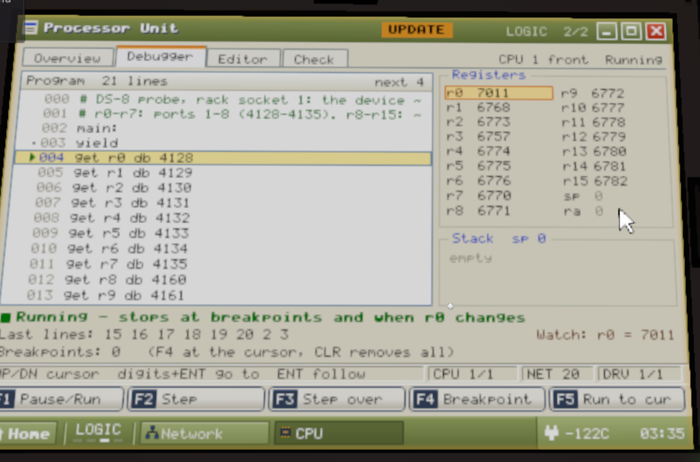
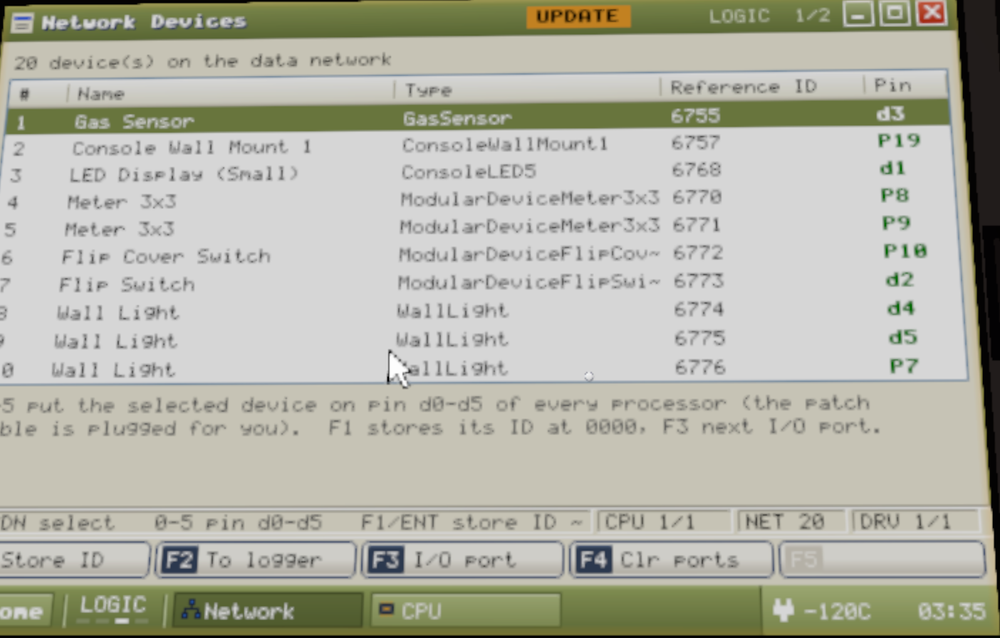
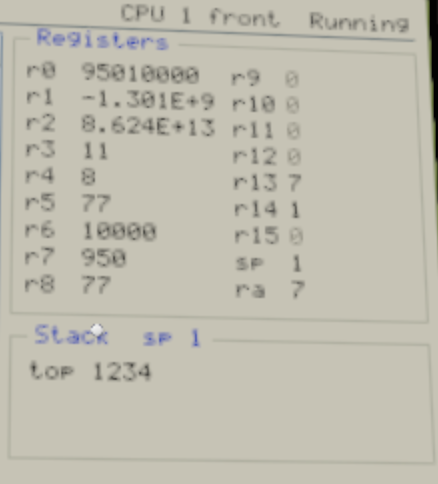

# DS-8 in-game tests

The [DS-8 furnace scripts](../FurnaceControl/README.md) were tested only in IC10 Bench. The bench
copies the rack from the mod's code, and the console parts from the game's device list. These
tests check, in game, the things the scripts rely on that the bench can't prove.

Each test says what to build, how to set it, what to do, and what to write down. Fill in the
**Got** column as you go (or send screenshots). Tick nothing that you didn't see.

| Session | What it checks | Needs |
| --- | --- | --- |
| [A. The rack](#a-the-rack) | Ports, `ld`/`sd` by ID, drives, scratch cells, power cycles, saves | A DS-8 rack, a drive, a few vanilla devices |
| [B. Console parts](#b-console-parts) | Levers, buttons, dials, displays, lights, gauges | An IC Housing and the console parts |
| [C. The Advanced Furnace](#c-the-advanced-furnace) | RecipeHash, Reagents, Activate | An Advanced Furnace you can heat, and iron ore |
| [D. The whole setup](#d-the-whole-setup) | The ten furnace chips together | Everything in the furnace README |

Run A first: if the ports don't work the way A1 expects, the furnace scripts need changing before
D.

## Before you start

**Probe scripts.** Each test runs one of the `DS8 Probe … .ic10` scripts in this folder. Paste
it into a chip as you did for the earlier audits. The registers it fills are listed at its top.

**A chip for a rack socket.** Program the chip in an IC Housing first, then pull it out and push
it into the rack socket. Test A0 checks this works, and whether other ways do.

**Reading a socket chip's registers.** In the rack's **CPU** program (press **HOME**, then pick
CPU), **TAB** to the **Debugger** tab, and pick the processor with the **CPU** key. It lists the
registers and the stack (A0.6: the IC10 Inspector sees only the rack, not its chips).

**Reading an IC Housing chip's registers.** Use the IC10 Inspector, as before.

## A. The rack

### Build (for all of A)

1. A DS-8 Server Rack on **its own** data network, with power. The power cable goes in bottom
   left at the back, the data cable bottom right.
2. A **Motherboard (Logic)** in the slot behind the monitor: pull the red pin above the screen and
   swing the monitor open by its grip.
3. One **Data Drive** in **bay 1**. Leave bay 2 empty.
4. On the same data network: one **Lever** (vanilla), one **Console LED 5**, and a **Gas Sensor**.
   For A1's second part you'll need **nine or more** devices on the network; any will do (lights,
   more sensors).
5. **MAIN POWER** on: the tower on top turns green.
6. Switches: **I/O** on, **MEM WR** on, **LOCK** off, **CLOCK** HI, **TURBO** off.
7. In the service bay or on the bank port, the drive's **WP** (write protect) switch is off.

### A0. Getting a program into a socket

1. Put `DS8 Probe Ports.ic10` on a chip in an IC Housing, then move the chip into rack socket 1.
2. Open the CPU program's **Overview** tab.

| # | Question | Expected | Got |
| --- | --- | --- | --- |
| A0.1 | Does processor 1 show running, with its program? | Running | Running|
| A0.2 | Did the chip keep its program when moved? | Yes |Yes |
| A0.3 | Does a new file appear in the save's `chipdata` folder for the socket chip? Its name? | Unknown |Its the name of the IC chip itself not housing(Same as how housing works) |
| A0.4 | Does `npm run ic-link:status` list it? | Unknown | Yes|
| A0.5 | Can a Computer's IC editor, with the rack's **PROG** selector on 1, read and change it? | Yes |yes |
| A0.6 | Does your IC10 Inspector cartridge see socket chips? | Unknown | No, it shows the entire rack, with empty registers, and stack of all 0s (512 of them).  However, the rack has its own inspector window.  |

### A1. How devices get onto ports

The furnace scripts expect each device on a fixed port, 1 to 25. This test finds out whether
you can choose the port, or only take the next free one.

Probe: `DS8 Probe Ports.ic10` in socket 1. Its r0-r7 are ports 1-8 and r8-r15 are ports 9-16;
0 is an empty port.

1. Check every register reads 0. Write down any that don't.
2. In the rack's **Network** program, pick the **Lever** and press **F3**. Write down which
   register changes.
3. Do the same for the **Console LED 5**, then the **Gas Sensor**.
4. Look in the Network program for a way to type or pick a port number. Try to move the Gas
   Sensor to port 21, and to empty a port.
5. Give more devices a port with F3 until one lands past port 8 (r8 or later).
6. Pick a device with no port and press **0** (pins in one key): it should become d0.

| # | Question | Expected | Got |
| --- | --- | --- | --- |
| A1.1 | Registers at the start | All 0 |All 0 |
| A1.2 | The Lever's port (which register) | Port 1 (r0) | 7011 (The ID of the lever)|
| A1.3 | The LED's, then the Gas Sensor's, port | Ports 2 and 3 |6768 (id of led), 6755 (id of sensor) |
| A1.4 | Can you choose a port number? How? | Unknown | Yes, by repeatedly clicking IO Port (F3) |
| A1.5 | Can you empty a port? How? | Unknown |Clear All, or cycle until empty  |
| A1.6 | After port 8, does F3 go on to port 9? | Yes (r8) |yes |
| A1.7 | Pressing 0: which port does the device land on, and does the patch cable move? | A free port 1-8 | d0 |
| A1.8 | Does the Network program show each device's port? Where? | A Port column | in the pin column it does, d0-d6,the p7-p32|

**What A1 found.** Each F3 press moves the device to the next free port, so pressing it until
the Pin column shows the port you want picks any port. Ports 1-6 show as d0-d5 (their patch
cables go to those pins), and ports 7-32 as P7-P32. F4 (Clr ports) empties them all. The
furnace's fixed ports work.

**F1 (and ENT) in the Network program** "stores its ID at 0000": drive cell 0. The furnace's
recipe count moved to cell 511 because of it.

### A2. Talking to a device by its ID

Probe: `DS8 Probe By ID.ic10` in socket 1. The Lever must be on **port 1** and the LED on
**port 2** (empty the ports and redo A1's steps 2-3 if not).

1. Watch the LED for a few seconds.
2. Throw the Lever on, then off.

| # | Question | Expected | Got |
| --- | --- | --- | --- |
| A2.1 | r0 and r1 (the two IDs) | Not 0 | Looks like the IDs|
| A2.2 | r3 (port 1 holds the Lever's ReferenceId) | 1 |1 constant |
| A2.3 | Does the LED count up (r5)? | Yes | Yes|
| A2.4 | r4 with the Lever off, then on | 0, then 1 | 0, then 1|
| A2.5 | Switch **I/O** off. Do r0 and r1 still show the IDs? Does the chip stop with an error, and on which line? | The mod's code says: the IDs still read, and the chip stops at the `ld` line ("must be device i| Yes Error, "DeviceListNull in line 10.  ld and sd with an ID read from a port.  No devices of that kind on the network.
| A2.6 | Switch **I/O** back on. Does the chip start again by itself, or does it need restarting (CPU program, F1)? | Unknown | yes|

### A3. Drive and scratch cells

Probes: `DS8 Probe Memory.ic10` in **socket 1**, `DS8 Probe Scratch.ic10` in **socket 2**.

1. Let both run for a few seconds.

| # | Register | Expected | Got |
| --- | --- | --- | --- |
| A3.1 | Memory r0 (ticks) and r1 (drive cell 511) | Climbing, and equal | correct|
| A3.2 | Memory r2 (cell 512, bay 2 empty) | 0, no error | r2 = 0|
| A3.3 | Memory r3 (drives online), r4 (capacity) | 1, 512 |correct |
| A3.4 | Memory r5 (its processor number) | 1 | correct|
| A3.5 | Memory r6 (faults) | Above 0 and climbing (each read of empty bay 2 counts) | correct|
| A3.6 | Memory r7 (scratch 4142, from socket 2) | 99 | correct|
| A3.7 | Memory r10, r11 on the first run | 0, 0 | correct|
| A3.8 | Scratch r0 (socket 1's tick count, through scratch 4143) | Same as Memory r0, or one behind |correct, same |
| A3.9 | Scratch r1 (its processor number) | 2 | correct|

### A4. MEM WR off

1. With A3 running, switch **MEM WR** off. Wait a few seconds, then switch it back on.

| # | Question | Expected | Got |
| --- | --- | --- | --- |
| A4.1 | While off: does Memory r0 keep climbing (no error)? | Yes |yes |
| A4.2 | While off: does r1 stop at its last value? | Yes | yes|
| A4.3 | While off: Memory r7 (socket 2 writing scratch) | Still 99 | yes|
| A4.4 | When back on: r1 catches up with r0 | Yes |yes |

### A5. The drive pulled out

1. With A3 running, pull the drive from bay 1. Wait a few seconds, then push it back in.

| # | Question | Expected | Got |
| --- | --- | --- | --- |
| A5.1 | While out: do the chips keep running, with no error? | Yes | yes, keeps running|
| A5.2 | While out: r1 and r3 | 0 and 0 | correct|
| A5.3 | Back in: r1 = r0 again, r3 = 1 | Yes | correct|

### A6. Power off and on

1. Write down Memory r0. Switch **MAIN POWER** off, wait until the tower goes dark, then switch it
   on again.

| # | Question | Expected | Got |
| --- | --- | --- | --- |
| A6.1 | Memory r0 after: small again (the chip started over at line 0)? | Yes | no, it is where it left off.|
| A6.2 | Memory r10 (drive cell 101 from last run) | 5555 | r10=0, in memory editor, 0101 is 5555 |
| A6.3 | Memory r11 (scratch 4141 from last run) | **Unknown**: 4242 means the scratch cells survive a power cycle, 0 means they're cleared |  4242|
| A6.4 | Did both processors start again by themselves? | Yes | yes |

### A7. Save and load

1. Save the game, quit to the menu, and load it again.

| # | Question | Expected | Got |
| --- | --- | --- | --- |
| A7.1 | Memory r10 | 5555 | 0, but but memory 0101 is 5555|
| A7.2 | Memory r11 | Unknown, as A6.3 |4242 |
| A7.3 | Are the ports from A1 still assigned (run the Ports probe again)? | Yes | yes|

**What A6 and A7 found.** A power cycle doesn't start a chip over: with the chips paused, the
next line, the registers and the memory cells were all where they were. So r10 and r11 are from
an earlier start, at some other time (r10 = 0 there suggests the drive wasn't online then).
[A9](#a9-when-does-a-chip-start-over) finds which actions do start a chip over.

### A8. How the game reads numbers

Probes: `DS8 Probe Numbers.ic10` in socket 1 (socket 2 can be empty), then
`DS8 Probe Case.ic10`, also in socket 1: it shows too whether `alias` and `define` work in a
socket.

**First run, 2026-10-20:** the Numbers probe stopped with `IncorrectVariable` at line 6,
`move sp 0`. In a later run, `jal test` then `j ra` worked (ra = 7), and a push made sp 1.
The game adds the `sp`, `ra` and `db` names whenever the chip's holder is a circuit holder,
which the rack is, so `sp` should have been there. One guess: that compile happened while the
chip wasn't in a holder (carried from the housing, or as the save loaded). Until it's settled,
the furnace chips use `r16` (sp) and `r17` (ra), which always work.

### A8b. sp and ra by name

Probe: `DS8 Probe Names.ic10` in socket 1. Run it three ways, and write down r10, r11, r12, or
the error and its line.

| # | How the chip got its program | Expected | Got |
| --- | --- | --- | --- |
| A8b.1 | Sent (ic10-link or pasted) while it sits in the socket | r10 = 6, r11 = 1, r12 = 1 | A new chip in socket 1: the first run stopped with IncorrectVariable at line 11 (`move r10 ra`). After "Processor 1 reset" in the CPU program, it worked. The Numbers probe, sent again to a chip already running there, also worked (2026-10-20) |
| A8b.2 | Programmed in an IC Housing, then moved to the socket | Same | It worked when I made a simple change to the chip while it was in an IC Housing.  So then I tried with a new chip, and it still worked on the first time. |
| A8b.3 | After A8b.1: save, quit to the menu, load | Same |The chip is continuely executing |

An `IncorrectVariable` at the `move r10 ra` or `move sp 0` line (11 or 12) means that way
leaves the chip without the name. If it does, try "Processor 1 reset" and note whether it then
works.

**So far:** a chip's first run in a socket can lack `sp` and `ra`, and a processor reset fixes
it. The reset doesn't recompile the chip (the mod's CpuReset only sends it back to line 0 and
clears its error), so the cause is in how the program first arrives. The furnace chips use
`r16` and `r17`, which don't depend on it.

| # | Register | Expected | Got |
| --- | --- | --- | --- |
| A8.1 | Numbers r0 (`push 0095010000`) | 95010000 | 95010000 |
| A8.2 | Numbers r1 (`HASH("ItemIronIngot")`) | -1301215609 | -1.301E+9 (as shown) |
| A8.3 | Numbers r2 (`STR("NoDisk")`) | 86239796097899 | 8.624E+13 (as shown) |
| A8.4 | Numbers r3 (`Color.Purple`) | 11 | 11 |
| A8.5 | Numbers r5 (written through `rr4`) | 77 | 77 |
| A8.6 | Numbers r6, r7 (the pair split) | 10000, 950 | 10000, 950 |
| A8.7 | Case: does it compile and run? | Unknown | Yes |
| A8.8 | Case r9, r10 | 1, 5 if names are case-sensitive | 1, 5 |

(A8.1-A8.6)
### A9. When does a chip start over?

A follow-up to A6 and A7. Probe: `DS8 Probe Restart.ic10` in **socket 1**. Socket 2 can be
empty. Each start adds 1 to scratch cell 4140, which A6 showed survives a power cycle.

1. Fit it and wait a few seconds. Write down r12, r13 and r10.
2. Do each action below, wait a few seconds, and write down r12, r13, r10 and r0.

| # | Action | Expected (if it starts over) | r12 | r13 | r10 | r0 |
| --- | --- | --- | --- | --- | --- | --- |
| A9.1 | First start | r12 = 1 (or more if scratch 4140 held something) |1 | 1| 0|17 |
| A9.2 | MAIN POWER off, tower dark, on | r12 the same, r0 carrying on (seen in A6) |2|1 | 7777|28 |
| A9.3 | Pull the drive, wait, push it back | Unknown | 2| 1| 7777|61 |
| A9.4 | MEM WR off, then on | Unknown | 2| 1| 7777|122 |
| A9.5 | I/O off, then on | Unknown | 2| 1| 7777|192 |
| A9.6 | Save, quit to the menu, load | Unknown | 2| 1| 7777|226 |
| A9.7 | Pull the chip from the socket and push it back | r12 + 1 | 3| 1|7777 |38 |

- the chip carried on where it was.
- **r13 = 0** at a start: the drive wasn't online yet. If so, r10 is 0 there, and the drive's
  writes at that moment (`put db 102 7777`) were lost. r1 later shows whether 7777 is in it.
**NOTE FROM HUMAN**: r12 went up when chip was replaced, or 'Processor 1 reset` was pressed. 

**What A9 found.** A chip starts over (at line 0) only when it's put back in its socket or its
processor is reset. A power cycle, the drive pulled, MEM WR, I/O, and a save and load all leave
it carrying on: r12 stayed 2 and r0 kept climbing. (A9.2's 2 came from a reset before it; r0
went on from 17 to 28 through the power cycle.) The drive was online at every start (r13 = 1).

**A8 and A8b, so far.** Everything the recipe setup and Status chips rely on reads as the bench
has it. Names are case-sensitive. A chip programmed in a housing and then moved, or loaded from
a save, has `sp` and `ra`; only a new chip given its program in the socket failed its first run.
## B. Console parts

### Build (for all of B)

1. An **IC Housing** on a data network of its own, with power, and **no rack** on it: the probes
   read each part by its kind, so there must be **one of each kind and no more**.
2. On that network:
   - Vanilla: **Lever**, **Switch**, **Button**, **Dial**, **Console LED 5**, **Diode**.
   - ModularConsoles, on a modular console that's on the network: **BigLever**,
     **FlipCoverSwitch**, **Switch**, **FlipSwitch**, **RoundButton**, **Dial**,
     **LEDdisplay3**, **Light**, **Gauge2x2**, **Gauge3x3**, **EdgewiseMeter3**.
3. Start with every lever and switch **off**, and both dials at 0.

Swap the probe in the housing for each test.

### B1. Where a lever keeps its position

Probe: `DS8 Probe Levers.ic10`.

1. Write down r0-r12 with everything off.
2. Turn **all** of them on, and write r0-r12 down again.

| Part | Registers | Off | On | Expected |
| --- | --- | --- | --- | --- |
| Lever | r0 Open, r1 Setting | | | Open 0 → 1; Setting unknown |
| Switch | r2 Open, r3 Setting | | | Open 0 → 1; Setting unknown |
| BigLever | r4 Open, r5 Setting | | | Open 0 → 1; Setting unknown |
| FlipCoverSwitch | r6 Open, r7 Setting, r8 On | | | Open 0 → 1; others unknown |
| Modular Switch | r9 Setting, r10 On | | | Unknown: which one follows it? |
| FlipSwitch | r11 Setting, r12 On | | | Unknown: which one follows it? |

The furnace scripts read **Open**. If the modular Switch or FlipSwitch follows Setting or On, it
could be supported too.

### B2. How long a button press lasts

Probe: `DS8 Probe Buttons.ic10`.

1. Press the vanilla Button five times, slowly. Then the RoundButton five times.
2. Then hold each one down for two seconds, once.

| # | Register | Expected | Got |
| --- | --- | --- | --- |
| B2.1 | After the clicks: r1 (Button presses), r0 (ticks at 1) | 5, 5 | |
| B2.2 | After the clicks: r3 (RoundButton presses), r2 (ticks at 1) | 5, 5 | |
| B2.3 | After holding: did r0 / r2 go up by 1, or by about 4 (2 s)? | Unknown | |

Five presses in five ticks means a chip reading every tick sees each press once, which is what
the Panel chip's Confirm needs.

### B3. A dial's Mode and Setting

Probe: `DS8 Probe Dials.ic10`. It sets both dials to Mode 17 and Setting 25 as it starts.

1. Write down r0-r3.
2. Turn each dial all the way up, then all the way down.

| # | Question | Expected | Got |
| --- | --- | --- | --- |
| B3.1 | r2, r3 (Modes) | 17, 17 | |
| B3.2 | r0, r1 just after the start (Setting 25 written) | 17 if it's clamped; 25 if not | |
| B3.3 | Turned all the way up: r0, r1 | 17, 17 | |
| B3.4 | All the way down | 0, 0 | |

### B4. Displays and lights

Probe: `DS8 Probe Displays.ic10`. The vanilla Dial picks what to show (it sets the dial's Mode to
9).

1. Turn the vanilla Dial from 0 to 9, one step at a time. At each step, write down what the
   Console LED 5, the LEDdisplay3, the Diode and the modular Light show.

| Dial | Expected text | Expected colour | LED 5 | LEDdisplay3 | Diode | Light |
| --- | --- | --- | --- | --- | --- | --- |
| 0 | Idle | Gray | | | | |
| 1 | Ready | Yellow | | | | |
| 2 | Hold | Orange | | | | |
| 3 | NoDisk | Purple | | | | |
| 4 | Active | Green | | | | |
| 5 | Unload | Blue | | | | |
| 6 | EMERG | Red | | | | |
| 7 | 1234 K | Red (left from 6) | | | | |
| 8 | 23.5 MPa (or 23500 kPa) | Red | | | | |
| 9 | 101 kPa or 101.3 kPa | Red | | | | |

### B5. Gauges

Probe: `DS8 Probe Gauges.ic10`. It sets each gauge to 0-3000 and shows 1500.

| # | Question | Expected | Got |
| --- | --- | --- | --- |
| B5.1 | Gauge2x2's needle | Half way | |
| B5.2 | Gauge3x3's needle | Half way | |
| B5.3 | EdgewiseMeter3's needle | Half way | |
| B5.4 | r1, r3, r5 (each PrefabHash matches its `HASH()`) | 1, 1, 1 | |
| B5.5 | r0, r2, r4 (the ReferenceIds) | Not 0 | |

### B6. Mode written to a gauge

Probe: `DS8 Probe Gauge Mode.ic10`. This one is meant to stop with an error.

| # | Question | Expected | Got |
| --- | --- | --- | --- |
| B6.1 | Does the chip stop? On which line, with which error? | At the `sd r0 Mode 3` line, IncorrectLogicType or similar | |
| B6.2 | r2, r3 | 1, 0 | |

## C. The Advanced Furnace

### Build

1. An **Advanced Furnace** you can fuel and heat. An existing one is fine: this probe only reads
   it, except in C4.
2. An **IC Housing** on the furnace's data network, with **d0** set to the furnace and **d1** to a
   vanilla **Lever** (off).
3. Probe: `DS8 Probe Furnace.ic10`.
4. If another chip controls this furnace, switch that chip off for these tests.

### C1. Cold, with ore in

1. With the furnace empty and cold, write down r0-r6.
2. Put in exactly **10 iron ore**. Write down r0-r2.
3. Add **10 more**, and write r2 down again.

| # | Register | Expected | Got |
| --- | --- | --- | --- |
| C1.1 | Empty: r0 (RecipeHash), r2 (Reagents) | 0, 0 | |
| C1.2 | 10 ore: r0, r1 (it's iron), r2 | Unknown, unknown, unknown | |
| C1.3 | 20 ore: r2 | Twice C1.2's? | |

### C2. Smelting

1. Fuel the furnace and light it (its own Activate, or your usual way). Let it reach the iron
   recipe's range: over 950 K and 100 kPa.
2. Once ingots are forming, write down r0-r6.

| # | Register | Expected | Got |
| --- | --- | --- | --- |
| C2.1 | r0 (RecipeHash) | -1301215609 | |
| C2.2 | r1 (it's iron) | 1 | |
| C2.3 | r2 (Reagents): same as C1, or changing as it smelts? | Unknown | |
| C2.4 | r5 (Combustion), r6 (Activate) | 1, 0 | |
| C2.5 | How many ingots did 20 ore give? | Unknown | |

The Panel chip shows Amount × 50 as the batch's Reagents for iron, and the batch ends when the
furnace's Reagents reach that. C1 and C2 tell whether 50 Reagents is one Amount step's worth.

### C3. Activate 0 while burning

The Fuel Pump chip writes Activate 0 every tick once the furnace is over 600 K.

1. While it's burning, throw the Lever **on** for 30 seconds, then off.

| # | Question | Expected | Got |
| --- | --- | --- | --- |
| C3.1 | Does it keep burning (r5 stays 1, r3 doesn't fall)? | Yes | |

### C4. Opening it

1. With ingots in it, open the furnace (from its own panel, or by setting Open 1).

| # | Question | Expected | Got |
| --- | --- | --- | --- |
| C4.1 | Do the ingots come out? | Yes | |
| C4.2 | r2 (Reagents) afterwards | 0 | |
| C4.3 | r0 (RecipeHash) afterwards | 0 | |

## D. The whole setup

Build the furnace setup as its [README](../FurnaceControl/README.md#setting-it-up) says, with the
ports A1 showed you can give. Then:

| # | Do | Expected | Got |
| --- | --- | --- | --- |
| D1 | Fit the nine running chips; the furnace off | Status `Idle`, Gray | |
| D2 | Furnace on | `NoDisk`, Purple | |
| D3 | Fit the Recipes Setup chip, MEM WR on | Within about 20 s: `Ready`, Yellow; the setup chip shows line `done` in the CPU program | |
| D4 | Take the setup chip out | Still `Ready` | |
| D5 | Turn the Ingot dial up as far as it goes | It stops at 17 | |
| D6 | Ingot 1 (Iron), Amount 2 | The amount display shows 100 | |
| D7 | Press Confirm | `Active`, Green; the fuel pump on; the pump display `Fuel` | |
| D8 | Once over 950 K and 100 kPa | Fuel pump off; the pump display `Off` | |
| D9 | Readouts | Furnace and box temperature and pressure as the furnace and Gas Sensor show them | |
| D10 | Vent lever on, then off | The box vents stop, then hold 101 kPa again | |
| D11 | When the batch is done | `Unload`, Blue; the furnace opens; ingots out | |
| D12 | After unloading | `Ready`; the Ingot dial back at 0 | |
| D13 | Start another batch, then pull the emergency release lever | `EMERG`, Red; the output wide open; pumps and mixer off | |
| D14 | Emergency lever back | `Ready` | |
| D15 | Flush lever on, between batches | The output opens wide | |
| D16 | Any chip stopped with an error? (CPU program, Overview) | None | |
