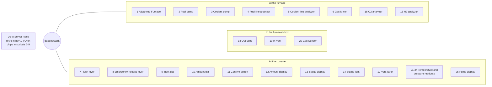
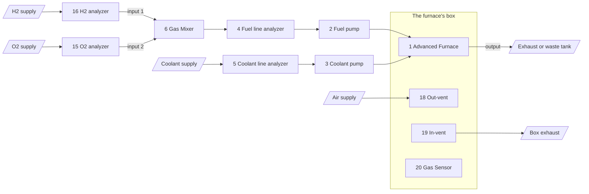
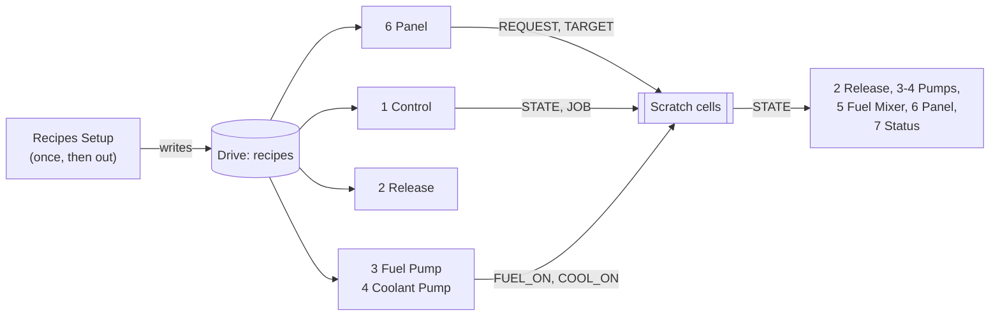

# Furnace Control (DS-8)

An Advanced Furnace run from a [DS-8 Server Rack](../README.md). It does what
[AdvFurnaceControl](../../FurnaceControl/AdvFurnaceControl/README.MD) does, rebuilt for the rack:

- **Recipes on a drive.** All 17 are written once, exactly. The old packed number lost some of each
  recipe's top pressure.
- **Devices on I/O ports,** not found by name. Set them in game, on the rack.
- **Vanilla or ModularConsoles parts,** for every lever, button, dial, display and light. The four
  temperature and pressure readouts can also be gauges.
- **A status display and light** (Idle, Ready, Active, Unload…), and a display showing which line
  is feeding the furnace: fuel, coolant, both or neither.
- **An emergency release lever** that opens the furnace's output, ends the batch and stops the
  pumps.

The work is split over nine small chips, so each one has plenty of room to read. A tenth chip
writes the recipes and then comes out. [REFERENCE.md](./REFERENCE.md) has what each chip does and the rack memory they share.

## How it fits together

Every device sits on the rack's data network, on the I/O port the number in its box gives.

The gas side: the fuel and coolant pumps both feed the furnace's input, and the box's two vents
hold the air around it at 101 kPa.

Inside the rack, the chips share the drive and the rack's scratch cells:

GitHub shows these diagrams; VS Code's Markdown preview needs a Mermaid extension.

## Setting it up

1. **Build the rack** on the furnace's data network. Put a drive in **bay 1**, and switch **I/O**
   on.
2. **Put each device on its port**, as below. In the rack's **Network** program, pick the device
   and press **F3** until its Pin column shows the port: ports 1-6 show as **d0-d5**, the rest as
   **P7-P32**. Going down the table in order, one F3 each usually does it. **F4** empties every
   port. (F1 or ENT there stores the device's ID in drive cell 0, which the furnace leaves
   alone.)
3. **Fit the chips** in sockets 1-9, in the order of the [chips table](./REFERENCE.md#the-chips).
   The status display shows `NoDisk`: the drive has no recipes yet.
4. **Write the recipes.** Put [Furnace Recipes Setup](./Furnace%20Recipes%20Setup.ic10) in a free
   socket, with **MEM WR** on and the rack not locked. When the status display changes to `Ready`
   (or `Idle`, with the furnace off), the recipes are in, and the chip can come out. The drive
   keeps them, even moved to another rack.
5. **Smelt.** Turn the Ingot dial to a recipe (below) and the Amount dial to how much, then press
   Confirm. The amount display shows the Reagents the batch will take.

| Dial | Recipes |
| --- | --- |
| 1-7 | Iron, Copper, Gold, Silicon, Silver, Lead, Nickel |
| 8 | Steel |
| 9-12 | Invar, Solder, Electrum, Constantan |
| 13-17 | Waspaloy, Inconel, Astroloy, Hastelloy, Stellite |

## The ports

| Port | Device | Port | Device |
| --- | --- | --- | --- |
| 1 | Advanced Furnace | 14 | Status light |
| 2 | Volume Pump, fuel line | 15 | Pipe Analyzer, O2 into the mixer |
| 3 | Volume Pump, coolant line | 16 | Pipe Analyzer, H2 into the mixer (its input 1) |
| 4 | Pipe Analyzer, fuel line (the mixer's output) | 17 | Vent lever |
| 5 | Pipe Analyzer, coolant line | 18 | Active Vent that fills the box |
| 6 | Gas Mixer | 19 | Active Vent that empties the box |
| 7 | Flush lever | 20 | Gas Sensor in the box |
| 8 | Emergency release lever | 21 | Readout: furnace temperature |
| 9 | Ingot dial | 22 | Readout: furnace pressure |
| 10 | Amount dial | 23 | Readout: box temperature |
| 11 | Confirm button | 24 | Readout: box pressure |
| 12 | Amount display | 25 | Pump display |
| 13 | Status display | | |

A chip that shows an error just after going into its socket: reset that processor in the CPU
program, and it starts again at line 0.

A chip waits, doing nothing, until every port it uses has its device. With the rack's **I/O**
switch off, the chips stop with an error at their first device; they carry on by themselves
when it's back on.

## Parts that work

| Role | Vanilla | ModularConsoles |
| --- | --- | --- |
| Levers (7, 8, 17) | Lever, Switch | BigLever, FlipCoverSwitch, Switch |
| Confirm button (11) | Button | RoundButton, SquareButton, UtilityButton2x2 |
| Dials (9, 10) | Dial | Dial, DialSmall |
| Displays (12, 13, 25) | LED displays (Console LED 5, 1x2, 1x3) | LEDdisplay2, LEDdisplay3 |
| Readouts (21-24) | any display above | any display above, or Gauge2x2, Gauge3x3, EdgewiseMeter3 |
| Status light (14) | Diode | Light, LightSmall, LightLarge, LabelDiode2, LabelDiode3 |

- **Displays and gauges.** A display shows kelvin, or pressure in its Pa mode: the chip writes
  pascals, and the display adds the prefix itself (`101 kPa`, `23.5 MPa`), for kelvin too
  (`1.50kK`). A gauge shows kelvin or kPa, from 0 to its scale: the scales are in the Readouts
  chip and are each chip's own ([REFERENCE.md](./REFERENCE.md#settings)).
- **What doesn't work.** A lever's position is read from its `Setting`, which ModularConsoles'
  FlipSwitch doesn't keep, so it can't be a lever. A Meter3x3 can't be a readout, since its top is
  read-only. A gauge on a display port stops its chip, since a gauge has no display mode.

## Status

| Display | Light | What it means |
| --- | --- | --- |
| `Idle` | Gray | The furnace is off. |
| `Ready` | Yellow | Waiting for Confirm. |
| `Hold` | Orange | Another chip has put the hold on (the HOLD scratch cell isn't 0). |
| `NoDisk` | Purple | No drive in bay 1, or no recipes on it. |
| `Active` | Green | A batch is running. |
| `Unload` | Blue | Done: the furnace is open until its ingots are out. |
| `EMERG` | Red | The emergency release lever is on. |

The pump display shows `Off` (gray), `Fuel` (orange), `Cool` (blue) or `Both` (purple).

## Levers

- **Flush:** between batches, opens the furnace's output wide. It also opens by itself above
  40000 kPa.
- **Vent:** on, the box's vents stop.
- **Emergency release:** at any time, opens the output wide, closes the input, stops both pumps and
  the mixer, and ends the batch. With the lever back, the furnace is Ready again. The Release chip
  reads this lever itself, so the output opens even if the Control chip has stopped.
